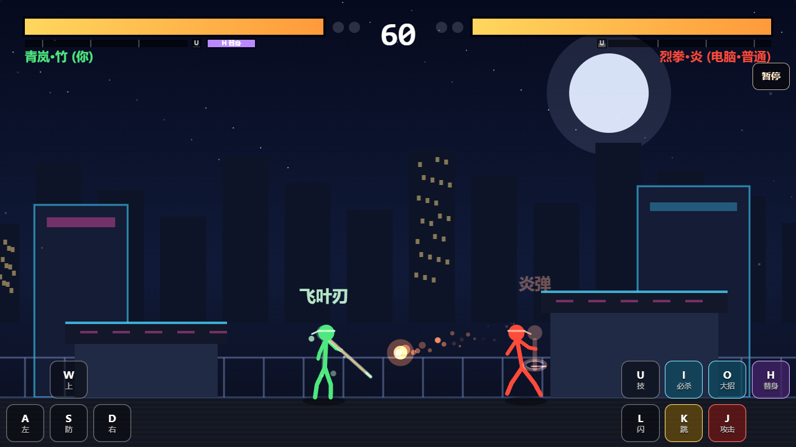

# Stick Fighter · 火柴人格斗

**[Play in your browser · 在线试玩](https://legend6leo.github.io/stick-fighter/)** · [中文说明](#中文说明) · [Controls / 键位表](#controls--键位表)

A single-player browser fighting game. Pick one of five stick fighters, face the CPU, and win two rounds. When you get caught in a combo, press **H** during a hit to leave a decoy and slip behind your opponent. The in-game menus and move names are in Chinese.

[](https://legend6leo.github.io/stick-fighter/)

## Your first match

1. Press **A / D** to pick a fighter and **J** to confirm. For a first game, try the red fighter **烈拳·炎**, whose **U** throws a fireball.
2. On the next screen, **A / D** changes the arena and **W / S** changes the difficulty. Choose **简单** for Easy and press **J** to fight.
3. Get close and tap **J** for a three-hit chain. With a full meter, spend it on a super (**O**) or awaken (**J + K** together) to power up your moves.

The five styles cover boxing, fast kicks, heavy strikes, a quick-draw sword and a long staff. The four arenas each have platforms you can jump through from below. On a phone, turn it sideways and tap the on-screen keys. Pause to see your fighter’s skill names, restart the match, mute sound, or reduce flashes and screen shake.

## Run locally

[Download the ZIP](https://github.com/legend6leo/stick-fighter/archive/refs/heads/main.zip), extract it, and open `index.html` in a browser. Keep `game.js` beside it. To get a Git checkout instead, run the command below and open `stick-fighter/index.html`.

```sh
git clone https://github.com/legend6leo/stick-fighter.git
```

The game runs directly from those two files. [index.html](index.html) contains the canvas, layout, touch buttons and pause menu. [game.js](game.js) handles input, CPU decisions, combat, Canvas 2D drawing and synthesized Web Audio effects.

## 中文说明

选一位火柴人，和电脑打一场先赢两回合的对决。五位角色里，烈拳·炎擅长拳法，疾影·风出腿快，崩山·岩血厚拳重，居合·刹靠拔刀抢时机，青岚·竹能用长棍从中距离压制对手。四张地图都有可以从下方跳上去的平台。

**第一局怎么打**

1. 用 **A / D** 选人，按 **J** 确认。第一次可以选红色的烈拳·炎，按 **U** 就能打出炎弹。
2. 用 **A / D** 切地图，**W / S** 切换简单、普通、困难，按 **J** 开战。手机横屏后，点同名虚拟键即可。
3. 贴近后连按 **J** 打三段普攻。被对手连击时，抓住受击瞬间按 **H**，可以留下残影、绕到对方背后。满气后，按 **O** 放大招，或同时按 **J + K** 觉醒，强化招式。

**本地运行**　[下载 ZIP](https://github.com/legend6leo/stick-fighter/archive/refs/heads/main.zip) 并解压，让 `index.html` 和 `game.js` 保持在同一目录，用浏览器打开 `index.html` 即可。画面由 Canvas 2D 绘制，音效由 Web Audio 合成，无需安装依赖或构建。

## Controls / 键位表

| Input / 按键 | In a fight | 对战中 |
| --- | --- | --- |
| A / D | Move left / right | 左右移动 |
| S (hold / 按住) | Guard on the ground | 地面防御 |
| K / L | Jump / dash | 跳跃 / 冲刺 |
| J | Basic attack. Tap in sequence to chain hits | 普攻，连续按可接三段连击 |
| U | Character skill. Costs no meter and has a cooldown | 角色技能，不耗气，有冷却 |
| I | Special move. Costs 30 meter | 必杀技，消耗 30 点气 |
| W or S + J / U / I | Hold a direction for the upper or lower move variant on the ground | 地面出招时按住 W 或 S，使出上派生或下派生 |
| H | Substitute during hitstun when ready | 受击硬直时替身，有冷却 |
| O / J + K | At full meter, use a super (O) or awaken (J + K together) | 满气按 O 放大招，或同时按 J + K 觉醒 |
| P / Esc | Pause or resume. On touchscreens, tap 暂停 to pause | 暂停或继续，触屏可点「暂停」 |

## Feedback / 问题反馈

If a move or touch input behaves unexpectedly, [open a gameplay report](https://github.com/legend6leo/stick-fighter/issues/new?template=gameplay.md). Include your fighter, device and the buttons you pressed.

如果遇到出招或触控问题，可以[提交游戏反馈](https://github.com/legend6leo/stick-fighter/issues/new?template=gameplay.md)，写下角色、设备、按键顺序，以及实际发生了什么。
